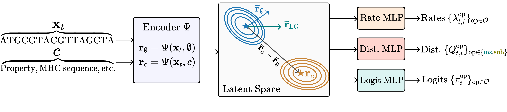

# FlexFlow

[Yogesh Verma](https://yoverma.github.io/yoerma.github.io/) | [Dani Korpela](https://scholar.google.com/citations?hl=en&user=oW-F1e4AAAAJ) | [Harri Lähdesmäki](https://www.aalto.fi/fi/ihmiset/harri-lahdesmaki) | [Vikas Garg](https://www.aalto.fi/en/people/vikas-kumar-garg)

Repository for the paper **"Flexible Flows for Biological Sequence Design"** (NeurIPS 2026).

<p align="center">
  
</p>

## Citation
If you find this repository useful in your research, please consider citing the following paper:
```bibtex
@inproceedings{
flexflow,
title={Flexible Flows for Biological Sequence Design},
author={Verma, Yogesh and Korpela, Dani and L{\"a}hdesm{\"a}ki, Harri and Garg, Vikas},
booktitle={The Fortieth Annual Conference on Neural Information Processing Systems},
year={2026},
url={https://openreview.net/forum?id=rxmkkL4trc}
}
```

Code will be updated soon!
